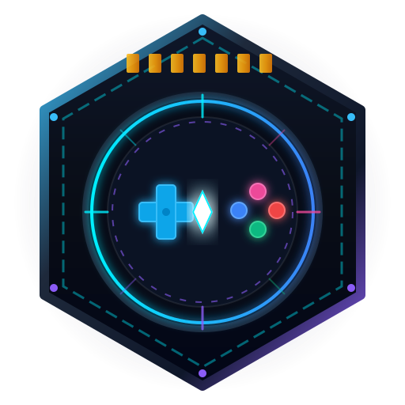

# OmniVault • ROM Finder, Metadata Catalog & Download Manager

<p align="center">
  
</p>

<p align="center">
  <strong>A high-performance, native macOS ROM &amp; game finder, 130k+ syncable 150+-system metadata catalog, zero-local-disk cloud streaming download manager, and Strict BYOS (Bring Your Own Sources) scraper hub.</strong>
</p>

<p align="center">
  
  
  
  <a href="https://github.com/NightKnight24/OmniVault/releases"></a>
  <a href="https://github.com/NightKnight24/homebrew-omnivault"></a>
  <a href="https://github.com/NightKnight24/OmniVault/pkgs/container/omnivault"></a>
  
  
</p>

---

## 🌟 Highlights

- **Full 150+ System TheGamesDB Catalog & Metadata Organizer**: 1-click **Resync Catalog** downloads all games across **150+ consoles, handhelds, computers & modern platforms** (**PS5**, **Nintendo Switch 2**, **Xbox Series X/S**, **Xbox One**, **Windows**, **macOS**, **Amiga**, **3DO**, classic 8/16/32/64-bit consoles & arcade) with all **30 categories/genres**, **8,700+ developers**, **4,700+ publishers**, **ESRB age ratings**, **multiplayer & co-op filters**, release eras, verified front box art, 1080p fanart backdrops, and screenshots — using `0` API quota calls *(zero copyrighted ROM files bundled)*.
- **Cloud Sign-In & Zero-Local-Disk Direct Streaming (`iCloud Drive` • `Google Drive` • `OneDrive` • `WebDAV Cloud / NAS`)**: Connect your cloud drive via **1-click System / Desktop App Sign-In** (real iCloud quota readout + Google Drive Stream / OneDrive Files On-Demand), **WebDAV Cloud / NAS** (pCloud, Nextcloud, Koofr, Box, Synology NAS with zero API keys), or **OAuth 2.0 PKCE Browser "Sign in & Allow"** — streaming ROMs and Real-Debrid downloads straight through RAM into dedicated **`OmniVault/ROMs/<Console>/`** folders with **zero bytes written to your local drive**.
- **100% In-App Community Scrapers with Exact-Game Filtering**: Clicking any configured community source scrapes & queues downloads **directly inside OmniVault** (never opening external browser windows), with strict whole-word title normalization, Roman numeral & acronym resolution, sequel isolation, and Base/Update/DLC/Backport classification.
- **Inline Trailers & Gameplay Previews**: Watch game trailers and gameplay directly inside each game's detail showcase alongside box art, screenshots, and synopses.
- **Instant Filtering & 1-Click Resync**: Indexed SQLite queries (`<15ms`), abortable debounced filtering, `no-store` cache control, and toolbar **Refresh** + **Resync Catalog** buttons.
- **Open Preservation Default (`archive.org`) + BYOS + Test All Sources**: Ships with only **Internet Archive (`archive.org`)** enabled out of the box (toggleable/removable in Settings), zero commercial ROM or torrent URLs hardcoded in runtime code/databases, and a live concurrent **Test All Sources** health monitor across mirrors, Torznab/JSON/RSS feeds, TheGamesDB, Real-Debrid, and Cloud Drives.
- **Real-Debrid High-Speed Unlock (BYOT)**: Validates your token on save and dynamically unlocks all **280+ supported file hosters** and cached BitTorrent magnets over HTTPS, excluding video/social sites.
- **Sequential 1-at-a-Time Download Queue & Utilities**: Built-in HTTP direct downloader and `aria2c` BitTorrent worker executing strictly **1 download at a time** (reorder up/down/top, pause/resume queue, clear history), isolated per-title extraction for Windows/macOS/PS5, `CRC32`/`SHA1`/`MD5` checksum verification, lossless `.chd` / `.rvz` compression, and `.m3u` multi-disc playlist builder.

---

## 🚀 Quick Start Guide

### Option A: Install via Homebrew (Recommended)
```bash
brew tap NightKnight24/omnivault
brew install --cask omnivault
```

### Option B: Download Pre-compiled App (Zero Setup)
Download the standalone native macOS Apple Silicon app from **[GitHub Releases](https://github.com/NightKnight24/OmniVault/releases/latest)**:
1. Download **`OmniVault-v2.1.2-macOS-arm64.zip`**.
2. Unzip and drag `OmniVault.app` into `/Applications` (or `/Volumes/ROMS`).
3. Double-click to launch!

### Option C: Run via Docker / GHCR Package
Run the web catalog finder and sequential download manager (complete with `aria2c`, `7z`, and Google Drive / OneDrive REST cloud uploads):
```bash
docker run -d -p 19842:19842 \
  -v omnivault-data:/app/backend/data \
  -v /path/to/roms:/roms \
  --name omnivault \
  ghcr.io/nightknight24/omnivault:latest
```

### Option D: Run From Source
Requirements: macOS 13.0+ (Apple Silicon recommended), Python 3.11+ / `uv`, Node.js / `npm`.
```bash
git clone https://github.com/NightKnight24/OmniVault.git
cd OmniVault
./build_app.sh   # or ./run.sh for development server
open /Volumes/ROMS/OmniVault.app
```

---

## ☁️ Cloud Sign-In & Zero-Local-Disk Streaming (iCloud Drive, Google Drive & OneDrive)

Every cloud download is automatically organized into its own dedicated console folder under **`OmniVault/ROMs/<Console>/`** (for example, `OmniVault/ROMs/SNES/`, `OmniVault/ROMs/PS5/`, `OmniVault/ROMs/Switch2/`):

1. **1-Click Browser "Sign in & Allow" (OAuth 2.0 Loopback + PKCE — Zero Local Disk Usage)**:
   - Open **Settings → Storage & Downloads → Cloud Drive Destinations** for **Google Drive** or **OneDrive**, enter your free public Desktop OAuth Client ID once (no client secret needed with PKCE; zero Google/Microsoft keys are ever bundled in GitHub), and click **Browser Sign-In**.
   - Click **Allow** in your browser — OmniVault catches the loopback callback at `127.0.0.1:19842` and enables **Direct Cloud Streaming**, piping HTTP & Real-Debrid downloads straight through an 8–10 MB RAM buffer into `OmniVault/ROMs/<Console>/` with **0 bytes written to your local drive**.
2. **1-Click System & Desktop App Sign-In (`iCloud Drive`, `Google Drive`, `OneDrive`)**:
   - Click **Sign in to iCloud** (opens macOS Apple Account / iCloud Settings) or **Sign in (GDrive / OneDrive App)** to connect via native cloud mounts (`~/Library/Mobile Documents/com~apple~CloudDocs` and `~/Library/CloudStorage/*`).
   - Enable **Cloud-Only Mode (Offload local copy after sync)** to automatically evict local blocks via macOS `brctl evict` once uploaded.

---

## 📖 Default Source & Bring Your Own Sources (BYOS)

Out of the box, OmniVault enables only **Internet Archive (`archive.org`)** via its official open-preservation search and metadata API (`archive_org` adapter), which can be toggled off or deleted anytime in Settings. Zero commercial ROM or torrent URLs are hardcoded — you supply any additional external sources and personal tokens you want to use:

### Method 1: Import a JSON Source Pack (Recommended)
1. Open **Settings → Sources & APIs**.
2. Scroll to **Import / Export BYOS Source Pack (JSON)**.
3. Paste a JSON Source Pack (or load a `.json` file from disk) and click **Import Source Pack**.

### Method 2: Connecting Torznab / Prowlarr / Jackett or Custom Feeds
1. Open **Settings → Sources & APIs**.
2. Choose **torznab**, **json_torrent_api**, or **rss_torrent_feed** (or click the **Prowlarr** / **Jackett** localhost presets).
3. Enter your **Endpoint URL** and optional **API Key**, click **Test Connection**, and **Save Provider**.

### Method 3: Real-Debrid & TheGamesDB Tokens
1. Under **Settings → Sources & APIs → TheGamesDB Metadata & Box Art**, OmniVault uses the built-in shared public key automatically, or you can enter your own free key from `thegamesdb.net` and use **Sync Titles** to pull Switch 2 / modern console catalogs.
2. Under **Settings → Sources & APIs → Real-Debrid High-Speed Debrid**, paste your personal token from `real-debrid.com/apitoken` to unlock HTTPS unrestriction for hoster links and cached magnets.

---

## 📦 Example BYOS Source Pack (JSON)

None of the sites below are hardcoded into OmniVault. Copy this JSON block (or save it as `sources.json`) and import it locally under **Settings → Sources & APIs → Import / Export BYOS Source Pack**:

```json
{
  "version": 1,
  "mirror_sources": [
    {
      "id": "r-roms",
      "name": "r/roms Megathread",
      "url": "https://r-roms.gitlab.io/",
      "adapter": "directory_link",
      "type": "Curated Preservation Directory",
      "description": "Reddit r/roms community directory for curated No-Intro & Redump collections.",
      "platforms": ["3DS", "PSVita", "NDS", "PSP", "PS1", "PS2", "PS3", "Switch", "Xbox", "Xbox360", "PS4", "GameCube", "Wii", "N64", "GBA", "SNES", "NES", "Genesis", "Dreamcast", "Saturn"],
      "search_template": "https://r-roms.gitlab.io/",
      "supports_direct_download": false,
      "priority": 70,
      "is_enabled": true,
      "config": {}
    },
    {
      "id": "consoleroms",
      "name": "ConsoleRoms",
      "url": "https://www.consoleroms.com/",
      "adapter": "slug_cdn",
      "type": "Retro ROM Directory",
      "description": "Fast index of classic console and arcade titles with direct CDN downloads.",
      "platforms": ["GBA", "GBC", "GB", "NDS", "SNES", "NES", "N64", "PS1", "PS2", "Xbox", "Arcade"],
      "search_template": "https://www.consoleroms.com/search?search_term_string={title}",
      "supports_direct_download": true,
      "priority": 10,
      "is_enabled": true,
      "config": {
        "search_path": "/search?search_term_string={query}",
        "item_path_prefix": "/roms/",
        "download_suffix": "/download",
        "cdn_url_regex": "https://downloads\\.consoleroms\\.com/roms/[^\"<>\\r\\n;]+",
        "cdn_domains": ["downloads.consoleroms.com", "consoleroms.com"],
        "platform_map": {
          "SNES": "snes",
          "NES": "nes",
          "N64": "n64",
          "GBA": "gba",
          "GBC": "gbc",
          "GB": "gb",
          "PS1": "psx",
          "PS2": "ps2",
          "NDS": "nds",
          "Arcade": "mame"
        }
      }
    },
    {
      "id": "romsfun",
      "name": "RomsFun",
      "url": "https://romsfun.com/",
      "adapter": "wp_ajax_cdn",
      "type": "Multi-Region Archive",
      "description": "Multi-region catalog with AJAX direct CDN stream resolution.",
      "platforms": ["3DS", "PSVita", "PSP", "NDS", "PS1", "PS2", "PS3", "PS4", "Xbox", "Xbox360", "Switch", "Wii", "GameCube", "GBA", "SNES"],
      "search_template": "https://romsfun.com/?s={title}",
      "supports_direct_download": true,
      "priority": 15,
      "is_enabled": true,
      "config": {
        "search_path": "/?s={query}",
        "item_path_contains": "/roms/",
        "download_path_contains": "/download/",
        "ajax_path": "/wp-admin/admin-ajax.php",
        "ajax_action": "k_get_download",
        "cdn_domains": ["romsfast.com", "psgamedl.com"],
        "platform_slugs": {
          "PS4": ["playstation-4", "ps4"],
          "PS3": ["playstation-3", "ps3"],
          "PS2": ["playstation-2", "ps2"],
          "PS1": ["playstation-1", "playstation", "ps1", "psx"],
          "PSP": ["playstation-portable", "psp"],
          "PSVita": ["playstation-vita", "psvita", "vita"],
          "Xbox": ["xbox"],
          "Xbox360": ["xbox-360", "xbox360"],
          "GameCube": ["gamecube", "gc"],
          "Wii": ["nintendo-wii", "wii"],
          "WiiU": ["wii-u", "wiiu"],
          "Switch": ["nintendo-switch", "switch"],
          "NDS": ["nintendo-ds", "nds"],
          "3DS": ["nintendo-3ds", "3ds"],
          "GBA": ["game-boy-advance", "gba"],
          "GBC": ["game-boy-color", "gbc"],
          "GB": ["game-boy", "gb"],
          "SNES": ["super-nintendo", "snes"],
          "NES": ["nintendo-entertainment-system", "nes"],
          "N64": ["nintendo-64", "n64"],
          "Genesis": ["sega-genesis", "genesis", "mega-drive"],
          "Dreamcast": ["sega-dreamcast", "dreamcast"],
          "Saturn": ["sega-saturn", "saturn"]
        }
      }
    },
    {
      "id": "ziperto",
      "name": "Ziperto",
      "url": "https://www.ziperto.com/",
      "adapter": "wp_hoster",
      "type": "Handheld Preservation Mirror",
      "description": "Switch, Switch 2, 3DS, and PS Vita Base/Update/DLC archive with Real-Debrid hoster extraction.",
      "platforms": ["Switch", "Switch2", "3DS", "PSVita"],
      "search_template": "https://www.ziperto.com/?s={title}",
      "supports_direct_download": false,
      "priority": 20,
      "is_enabled": true,
      "config": {
        "search_path": "/?s={query}",
        "link_selector": "a[rel='bookmark'], h2 a, h3 a",
        "file_kind": "rom",
        "platform_keywords": {
          "3DS": ["3ds", "cia"],
          "PSVita": ["vita", "vpk", "nonpdrm"],
          "Switch": ["switch", "nsp", "xci"],
          "Switch2": ["switch", "nsp", "xci"]
        }
      }
    },
    {
      "id": "dlpsgame",
      "name": "DLPSGame",
      "url": "https://dlpsgame.com/",
      "adapter": "wp_hoster",
      "type": "PlayStation PKG Mirror",
      "description": "PS5, PS4, and PS3 Base/Update/DLC/Backport PKG mirror with Real-Debrid hoster extraction.",
      "platforms": ["PS5", "PS4", "PS3"],
      "search_template": "https://dlpsgame.com/?s={title}",
      "supports_direct_download": false,
      "priority": 22,
      "is_enabled": true,
      "config": {
        "search_path": "/?s={query}",
        "link_selector": "a[href]",
        "file_kind": "pkg",
        "title_clean_regex": "\\b(PS5|PS4|PS3|PKG|Free Download|v\\d\\.\\d+)\\b",
        "platform_keywords": {
          "PS5": ["ps5"],
          "PS3": ["ps3"],
          "PS4": ["ps4", "pkg"]
        }
      }
    },
    {
      "id": "nswvault",
      "name": "NSWVault",
      "url": "https://nswvault.com/",
      "adapter": "wp_hoster",
      "type": "Nintendo Switch NSP/XCI Mirror",
      "description": "Dedicated Nintendo Switch & Switch 2 NSP, XCI, NSZ, update, and DLC directory.",
      "platforms": ["Switch", "Switch2"],
      "search_template": "https://nswvault.com/?s={title}",
      "supports_direct_download": false,
      "priority": 24,
      "is_enabled": true,
      "config": {
        "search_path": "/?s={query}",
        "link_selector": "a[href*='/roms/']",
        "subpage_link_regex": "/download/\\d+",
        "exclude_path_parts": ["/category/", "/tag/", "/author/", "orderby=", "page/", "#"],
        "title_clean_regex": "\\b(ROM Download|Download)\\b",
        "file_kind": "rom"
      }
    },
    {
      "id": "romslab",
      "name": "RomsLab",
      "url": "https://romslab.com/",
      "adapter": "wp_hoster",
      "type": "Modern & Retro Releases",
      "description": "Catalog of Switch, Switch 2, PS5, PS4, and retro releases with hoster mirrors.",
      "platforms": ["Switch", "Switch2", "PS5", "PS3", "PS4", "Xbox", "Xbox360", "3DS", "PSVita", "NDS", "Retro"],
      "search_template": "https://romslab.com/?s={title}",
      "supports_direct_download": false,
      "priority": 26,
      "is_enabled": true,
      "config": {
        "search_path": "/?s={query}",
        "link_selector": "h2 a, h3 a",
        "platform_keywords": {
          "PS5": ["ps5"],
          "PS4": ["ps4"]
        }
      }
    },
    {
      "id": "blueroms",
      "name": "BlueRoms",
      "url": "https://www.blueroms.ws/",
      "adapter": "platform_listing_token",
      "type": "Direct High-Speed Mirror",
      "description": "Tokenized CDN mirror for 3DS, Vita, Switch, PSP, NDS, PS1-4 & Xbox.",
      "platforms": ["3DS", "PSVita", "PSP", "NDS", "PS1", "PS2", "PS3", "PS4", "Xbox", "Xbox360", "GameCube", "Wii", "Switch", "Switch2", "N64", "GBA", "SNES", "Genesis", "Dreamcast", "Arcade"],
      "search_template": "https://www.blueroms.ws/",
      "supports_direct_download": true,
      "priority": 30,
      "is_enabled": true,
      "config": {
        "listing_path": "/{platform_slug}",
        "game_href_template": "/game/{platform_slug}/",
        "token_href_regex": "^/download/gAAAAAB",
        "cdn_url_regex": "https://files\\.blueroms\\.ws/",
        "cdn_domains": ["files.blueroms.ws", "blueroms.ws"],
        "default_platform_slug": "3ds",
        "platform_map": {
          "3DS": "3ds",
          "PSVita": "psvita",
          "PSP": "psp",
          "NDS": "nds",
          "PS1": "ps1",
          "PS2": "ps2",
          "PS3": "ps3",
          "PS4": "ps4",
          "Xbox": "xbox",
          "Xbox360": "xbox360",
          "GameCube": "gamecube",
          "Wii": "wii",
          "Switch": "switch",
          "Switch2": "switch2",
          "N64": "n64",
          "GBA": "gba",
          "SNES": "snes",
          "Genesis": "genesis",
          "Dreamcast": "dreamcast",
          "Arcade": "arcade",
          "NeoGeo": "neogeo"
        }
      }
    },
    {
      "id": "romsgames",
      "name": "RomsGames",
      "url": "https://www.romsgames.net/",
      "adapter": "html_search",
      "type": "Retro ROM Portal",
      "description": "Retro ROM portal & release search.",
      "platforms": ["NDS", "PSP", "GBA", "PS1", "PS2", "SNES", "NES", "N64", "GameCube", "Wii", "Genesis"],
      "search_template": "https://www.romsgames.net/search/?q={title}",
      "supports_direct_download": false,
      "priority": 45,
      "is_enabled": true,
      "config": {
        "search_path": "/search/?q={query}",
        "row_selector": "a[href]",
        "result_href_regex": "(?:-rom-|/roms/)",
        "exclude_keywords": ["emulator", "roms", "page"]
      }
    },
    {
      "id": "vimm",
      "name": "Vimm's Lair",
      "url": "https://vimm.net/",
      "adapter": "html_search",
      "type": "Historical Preservation Vault",
      "description": "Vintage vault catalog search and preservation verification.",
      "platforms": ["NES", "SNES", "N64", "GBA", "GameCube", "Wii", "PS1", "PS2", "PS3", "Xbox", "Xbox360", "PSP", "Genesis", "Dreamcast", "Saturn"],
      "search_template": "https://vimm.net/vault/?p=list&q={title}",
      "supports_direct_download": false,
      "priority": 50,
      "is_enabled": true,
      "config": {
        "search_path": "/vault/?p=list&q={query}",
        "row_selector": "tr a",
        "result_href_regex": "^/vault/"
      }
    }
  ],
  "providers": [
    {
      "id": "tpb_games",
      "name": "The Pirate Bay",
      "type": "json_torrent_api",
      "endpoint_url": "https://apibay.org/q.php",
      "is_enabled": true,
      "config": {
        "query_param": "q",
        "cat_param": "cat",
        "category": "400"
      }
    },
    {
      "id": "nyaa_games",
      "name": "Nyaa.si",
      "type": "rss_torrent_feed",
      "endpoint_url": "https://nyaa.si/",
      "is_enabled": true,
      "config": {
        "rss_query_template": "?page=rss&q={query}&c=6_0",
        "trackers": [
          "http://nyaa.tracker.wf:7777/announce",
          "udp://open.stealth.si:80/announce",
          "udp://tracker.opentrackr.org:1337/announce",
          "udp://tracker.torrent.eu.org:451/announce"
        ]
      }
    }
  ],
  "search_templates": [
    {
      "id": "tpl-duckduckgo",
      "name": "DuckDuckGo Preservation Search",
      "url_template": "https://duckduckgo.com/?q={title}+{platform}+preservation",
      "description": "General web search shortcut",
      "is_enabled": true
    }
  ]
}
```

---

## 🛠️ Developer & Build Guide

### Running in Development Mode
```bash
# Terminal 1: Backend API
cd backend
uv venv .venv
uv pip install -r pyproject.toml
.venv/bin/uvicorn app.main:app --reload --port 19842

# Terminal 2: Frontend
cd frontend
npm install
npm run dev
```

### Compiling the Standalone macOS App Bundle
```bash
./build_app.sh
```
This builds `frontend/dist`, packages the Python backend and runtime, compiles the native `arm64` Swift binary, and signs `OmniVault.app`.

---

## ⚖️ Legal Disclaimer

- **OmniVault is an open-source software project** developed for historical game cataloging, preservation metadata indexing, and file management.
- OmniVault **does not host, bundle, or distribute any copyrighted game ROMs, proprietary BIOS dumps, decryption keys, or hardcoded commercial download links**.
- All product names, logos, and trademarks belong to their respective owners.
- Users are solely responsible for ensuring that any external BYOS sources they add comply with applicable local laws.

---

## 📄 License

This project is licensed under the [MIT License](LICENSE).
