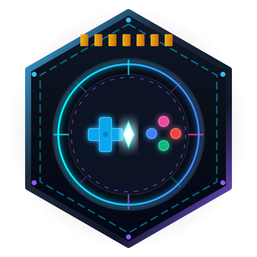

# OmniVault • Native Classic Retro Storefront & Preservation Hub

<p align="center">
  
</p>

<p align="center">
  <strong>A high-performance, native macOS retro game metadata catalog, 3D interactive storefront, and standalone hardware emulator launcher powered by Bring Your Own Sources (BYOS).</strong>
</p>

<p align="center">
  
  
  
  <a href="https://github.com/NightKnight24/OmniVault/releases"></a>
  <a href="https://github.com/NightKnight24/OmniVault/issues"></a>
  <a href="https://github.com/NightKnight24/OmniVault/discussions"></a>
  <a href="https://github.com/NightKnight24/OmniVault"></a>
  
</p>

---

## 🌟 Highlights

- **Massive 67k Metadata & Lore Catalog**: An indexed encyclopedia of 67,594 classic games across 35 systems (PlayStation 1–4, PSP, Vita, Nintendo NES to Switch, GameCube, Wii, Wii U, NDS, 3DS, Sega Genesis, Saturn, Dreamcast, Xbox, Arcade, etc.) with release years, developers, reviews, and gameplay synopses *(Zero copyrighted ROM files bundled)*.
- **Physical Media in 3D**: Real-time 3D rendered cartridges, CD jewel cases, DVD boxes, and optical game discs with interactive 360° spin and packaging views.
- **Standalone Emulator Integration**: Seamless 1-click launch routines for 13 standalone native emulators (Dolphin, RetroArch, PCSX2, RPCS3, Ryujinx, Cemu, Azahar/Lime3DS, Vita3K, xemu, melonDS, PPSSPP).
- **Bring Your Own Sources (BYOS)**: Ships 100% clean and legal. Connect Archive.org collections, Torznab/Prowlarr indexers, personal NAS servers, or community web directories.
- **Embedded Local AI Copilot (OmniAI)**: Powered by local neural models (`Qwen2.5 0.5B`) running directly on Apple Silicon Metal GPUs. Answers gameplay questions, generates save file diffs, and provides walkthroughs without needing internet.
- **Living-Room 10-Foot Kodi View**: Full controller-driven Big Picture mode with ambient glowing palettes, sound effects, and customizable themes.

---

## 🚀 Quick Start Guide

### 1. Requirements
- macOS 13.0 (Ventura) or later (Apple Silicon M1/M2/M3/M4 recommended).
- Python 3.11+ (or [uv](https://github.com/astral-sh/uv) package manager).
- Homebrew (recommended for standalone emulator dependencies).

### 2. Launch OmniVault
Clone the repository and run the launcher:
```bash
git clone https://github.com/NightKnight24/OmniVault.git
cd OmniVault
./run.sh
```

*(Alternatively, download the pre-compiled macOS release archive from the [GitHub Releases](https://github.com/NightKnight24/OmniVault/releases) tab).*

On first launch, OmniVault automatically:
1. Decompresses the clean 67k-title database (`vault.db.gz`).
2. Configures a local Python virtual environment.
3. Launches the native standalone desktop application window.

---

## 📖 Complete Tutorial: Bring Your Own Sources (BYOS)

OmniVault is engineered with a **Bring Your Own Sources (BYOS)** architecture. Out of the box, the public repository contains **zero copyrighted game ROMs and zero hardcoded commercial links**.

Instead, OmniVault gives you a powerful multi-protocol scraping engine that connects your library to your preferred storage locations:

```
┌────────────────────────────────────────────────────────────────────────┐
│                          OmniVault Core Hub                            │
│           (67,594 Game Metadata • 3D Covers • Emulator Launchers)      │
└──────────────────────────────────┬─────────────────────────────────────┘
                                   │
         ┌─────────────────────────┼─────────────────────────┐
         ▼                         ▼                         ▼
┌──────────────────┐      ┌──────────────────┐      ┌──────────────────┐
│  Archive.org     │      │ Torrent / Magnet │      │ Personal NAS /   │
│  Collections     │      │ (Torznab/Apibay) │      │ Open Directories │
└──────────────────┘      └──────────────────┘      └──────────────────┘
```

### Method 1: Adding an Archive.org Collection
Internet Archive hosts thousands of verified public domain, homebrew, and community game collections:
1. Open OmniVault and navigate to **Settings** (or click the **Sources** icon in the navbar).
2. Under **Custom Providers**, select **Add Source**.
3. Choose **Internet Archive** and enter:
   - **Name**: e.g. `SNES Preservation Archive`
   - **Collection / Item Identifier**: e.g. `nointro-snes` or any collection identifier from `archive.org/details/<identifier>`.
4. Click **Save Source**. OmniVault's indexer will automatically match the collection's files against your catalog, activating 1-click downloads for matched games.

---

### Method 2: Connecting Torznab / Prowlarr / Jackett (BitTorrent)
If you run a local media server with **Prowlarr** or **Jackett**:
1. Open **Settings → Sources → Add Provider**.
2. Select **Torznab Indexer**.
3. Fill in:
   - **Endpoint URL**: e.g. `http://localhost:9696/prowlarr/1/api`
   - **API Key**: Your Prowlarr / Jackett API key.
4. Click **Test Connection**. OmniVault will verify the feed. When you search for high-capacity titles (e.g., PS2, PS3, GameCube), OmniVault will query your indexer and download files via its native `aria2c` BitTorrent engine.

---

### Method 3: Pointing to a Personal NAS / HTTP Web Directory
If you have an Apache, Nginx, or home NAS file server:
1. Ensure directory listing is enabled on your folder (e.g. `http://nas.local/roms/snes/`).
2. In **Settings → Sources**, enter your web directory URL.
3. OmniVault's scraper will scan matching `.zip`, `.7z`, `.sfc`, or `.iso` archives and link them directly to the corresponding game cards.

---

### Method 4: Community Web Search Helpers (Vimm's Lair, RomsFun, etc.)
Some third-party websites (like Vimm's Lair, RomsFun, or Ziperto) use Cloudflare challenges, captchas, and timer redirects to prevent automated apps from scraping them.

OmniVault solves this with **Web Search Helpers**:
1. Open any game's detail modal (e.g. *Chrono Trigger*).
2. Under **Community Source & Web Lookups**, click:
   - `[ Internet Archive ↗ ]`
   - `[ DuckDuckGo ↗ ]`
   - `[ Vimm's Lair ↗ ]`
   - `[ RomsFun ↗ ]`
3. The query opens directly in your browser. Download the file, and OmniVault's auto-import listener in your `~/Downloads` folder will detect it, move it to `/Volumes/ROMS/<Platform>`, and mark it as ready to play!

---

### Method 5: Manually Attaching a Direct Link or Magnet
If you have an exact link or magnet URI:
1. Open the game details modal.
2. Click **Attach Source URL**.
3. Paste the direct `.zip` / `.iso` link or `magnet:?xt=urn:...` link.
4. Click **Save Link**. The download button will immediately activate for that game.

---

## 🎮 Hardware Emulators & BIOS Guide

OmniVault integrates natively with 13 standalone emulators:

| System / Console | Recommended Emulator | ROM Directory | Required BIOS / Keys |
| :--- | :--- | :--- | :--- |
| **NES, SNES, Genesis, GBA, Arcade** | **RetroArch** | `SNES/`, `NES/`, `Genesis/`, `GBA/` | Included in core / None |
| **GameCube, Wii** | **Dolphin Engine** | `GameCube/`, `Wii/` | None (DSP LLE optional) |
| **PlayStation 1 (PS1)** | **DuckStation** / **RetroArch** | `PS1/` | `scph5501.bin` in `BIOS/` |
| **PlayStation 2 (PS2)** | **PCSX2** | `PS2/` | `SCPH-39001.bin` in `BIOS/` |
| **PlayStation 3 (PS3)** | **RPCS3** | `PS3/` | `PS3UPDAT.PUP` (Sony Firmware) |
| **Nintendo 3DS** | **Azahar / Lime3DS** | `3DS/` | None (AesKeys optional) |
| **Nintendo Switch** | **Ryujinx** | `Switch/` | `prod.keys` & `title.keys` in `BIOS/` |
| **Nintendo Wii U** | **Cemu** | `WiiU/` | None |
| **Nintendo DS** | **melonDS** | `NDS/` | `bios7.bin`, `bios9.bin`, `firmware.bin` |
| **Original Xbox** | **xemu** | `Xbox/` | `mcpx_1.0.bin` & `Complex_4627.bin` |
| **PS Vita** | **Vita3K** | `PSVita/` | `PSP2UPDAT.PUP` (Sony Firmware) |

### Automatic BIOS Verification
Open **Settings → BIOS & Firmware Audit** to see a live visual status indicator for all systems. OmniVault automatically scans your `BIOS/` folder and matches checksums for required firmware files.

---

## 🧠 Local Neural AI Copilot (OmniAI)

OmniVault comes equipped with an embedded local LLM copilot:
- **Model**: `Qwen2.5 0.5B Instruct` (GGUF format).
- **Hardware Acceleration**: Apple Silicon Metal GPU offload (runs offline with 0 cloud dependencies).
- **Features**:
  - Natural language game recommendations ("Find 2-player co-op beat-em-ups on Sega Genesis").
  - Walkthrough assistance when you're stuck on a puzzle or boss.
  - Non-destructive save state diffing (analyzing money/lives offsets).

To enable the local neural model:
1. Open **Settings → AI Copilot**.
2. Click **Download Local Neural Model (469 MB)**. OmniVault will fetch it once from HuggingFace and cache it in `backend/data/models/`.

---

## 📺 Living-Room Kodi 10-Foot Mode

Press the **Kodi Mode** button in the top navigation bar or press `F11` to toggle the 10-foot living-room media center view:
- Seamless navigation with DualSense, DualShock 4, Xbox Series X/S, or Nintendo Switch Pro controllers.
- Ambient glowing banners, game sound effects, and audio feedback.
- Customizable theme engine: Kodi Estuary, PlayStation Quantum Flow, SNES Super Classic, Cyberpunk Neon, and CRT Arcade.

---

## 🛠️ Developer & Build Guide

### Running in Development Mode
Run frontend and backend independently with live hot-reloading:

```bash
# Terminal 1: Backend API
cd backend
uv venv .venv
uv pip install -r pyproject.toml
.venv/bin/uvicorn app.main:app --reload --port 19842

# Terminal 2: Frontend
cd frontend
npm install
npm run dev
```

### Compiling the Standalone macOS App Bundle
To compile `OmniVault.app` with the native Swift WKWebView wrapper:
```bash
./build_app.sh
```
This packages the frontend build, backend service, and native arm64 binary into `OmniVault.app`.

---

## 💬 Community, Issues & Discussions

Connect with fellow preservation enthusiasts, ask questions, share source templates, or report bugs:

- 💬 **[Join GitHub Discussions](https://github.com/NightKnight24/OmniVault/discussions)**:
  - **Q&A**: Get help with emulator configurations, BIOS placement, or gamepad setup.
  - **Ideas & Feature Requests**: Propose new console cores, theme designs, or UI improvements.
  - **Source Lists & Community Feeds**: Share public domain archives and legal preservation collections.
- 🐛 **[Submit an Issue or Bug Report](https://github.com/NightKnight24/OmniVault/issues)**:
  - Report unexpected errors, launch failures, or scraper glitches.
- ⭐ **Star the Repository**:
  - If you enjoy OmniVault, star the repository to support historical game preservation!

---

## ⚖️ Legal Disclaimer

- **OmniVault is an open-source software project** developed for historical game preservation, educational study, and fair-use cataloging of homebrew and public-domain retro software.
- OmniVault **does not host, bundle, or distribute any copyrighted game ROMs, proprietary BIOS dumps, or cryptographic decryption keys**.
- All product names, logos, trademarks, and registered trademarks belong to their respective owners (Nintendo, Sony Interactive Entertainment, Microsoft, Sega, Capcom, Square Enix, Konami, Bandai Namco, etc.). Reference to these trademarks does not imply any affiliation, sponsorship, or endorsement.
- Users are solely responsible for ensuring that their use of external preservation sources complies with their local copyright laws.

---

## 📄 License

This project is licensed under the [MIT License](LICENSE).
